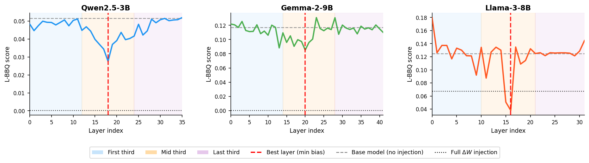
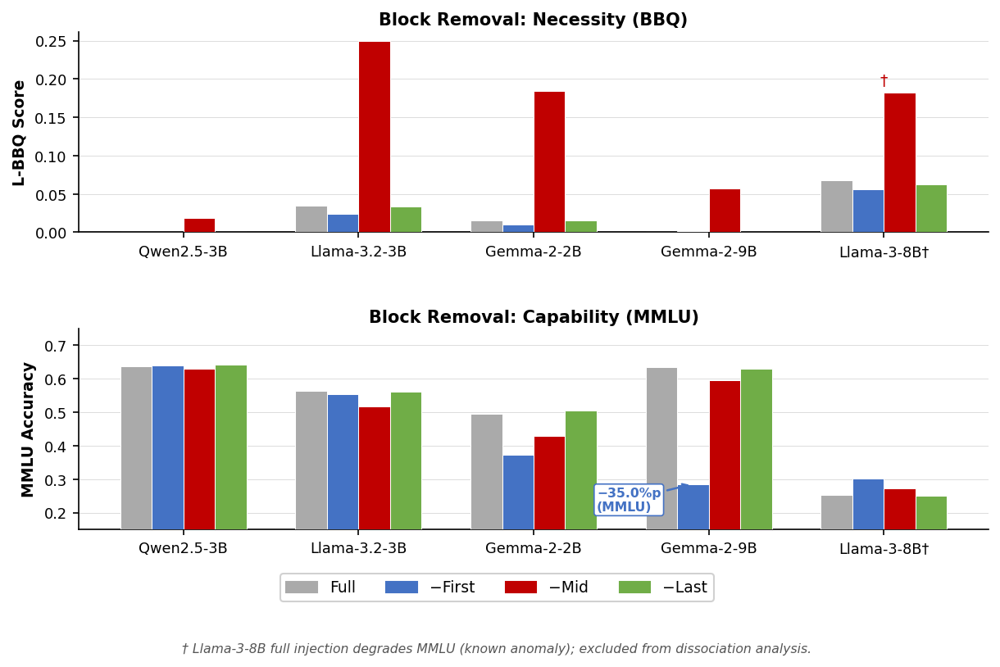

# LEVEE: Layer-wise Evaluation of Vector Encoding Effects

**EMNLP 2026 (Main Conference)** · Dongmin Kim, Youhyun Shin

*LEVEE: Layer-wise Evaluation of Vector Encoding Effects — Bias Localization and Functional Separation across 11 LLMs*

[Quick start](#quick-start) · [Key results](#key-results) · [Reproducing](#reproducing-main-results) · [Scoring](#scoring-paper-32) · [Citation](#citation)

---

## Overview

Task-vector methods treat the alignment update ΔW = W_instruct − W_base as one
monolithic object. We open it up: we inject each layer's ΔW into the base model
independently and measure bias (BBQ) and capability (MMLU), across 11
instruction-tuned LLMs (0.5B–14B; Qwen2.5, Gemma-2/3, Llama-3.x). Five designs
cover sufficiency (per-layer sweep, cumulative injection), necessity (block
removal), and directional specificity (sign-flip, norm-matched controls).



**Three main findings:**

1. **Layer-wise localization** — all 9 structured-signal models show a mid-third
   minimum in the per-layer BBQ profile; mid-third block removal raises L-BBQ in
   all 11 models (ΔL-BBQ +0.007 to +0.215) and is the most critical third in 10 of 11.
2. **Functional separation** — in Gemma-2 models, removing the first third reduces
   MMLU by up to 35.0 pp (Gemma-2-9B) with |ΔL-BBQ| ≤ 0.006, while mid-third
   removal causes larger BBQ changes but smaller MMLU losses.
3. **Active suppression** — in 3 of 11 models (Gemma-2-2B, Llama-3.2-3B,
   Llama-3-8B), removing the mid-third yields a model *more biased than the
   unaligned base* (up to +46% above base): partial ΔW transfer that omits the
   mid-third can be worse than no transfer.

**Models tested:** Qwen2.5 (0.5B/1.5B/3B/14B), Gemma-2 (2B/9B), Gemma-3-12B,
Llama-3.2 (1B/3B), Llama-3-8B, Llama-3.1-8B.

## Key results



Block removal (paper Table 4). `base` is the un-injected L-BBQ; the other columns are
ΔL-BBQ relative to full ΔW (positive = more biased after removing that third).
**Bold** = post-removal bias exceeds `base` (active suppression).

| Model | base | −mid | −first | −last |
|---|---:|---:|---:|---:|
| Qwen2.5-0.5B ‡ | 0.252 | +0.078 | +0.119 | −0.003 |
| Qwen2.5-1.5B ‡ | 0.273 | +0.118 | +0.045 | +0.004 |
| Qwen2.5-3B | 0.050 | +0.019 | <0.001 | <0.001 |
| Qwen2.5-14B | 0.013 | +0.007 | <0.001 | <0.001 |
| Gemma-2-2B | 0.160 | **+0.169** | −0.006 | <0.001 |
| Gemma-2-9B | 0.116 | +0.057 | +0.001 | <0.001 |
| Gemma-3-12B | 0.095 | +0.069 | +0.020 | <0.001 |
| Llama-3.2-1B | 0.251 | +0.111 | +0.014 | +0.013 |
| Llama-3.2-3B | 0.176 | **+0.215** | −0.011 | −0.002 |
| Llama-3-8B | 0.125 | **+0.115** | −0.011 | −0.005 |
| Llama-3.1-8B | 0.118 | +0.030 | +0.028 | −0.001 |

‡ diffuse-signal models (Qwen2.5-0.5B/1.5B); Llama-3.1-8B is borderline (see paper).
`base` values are as printed in the paper; they can differ from the pre-computed
JSONs in the third decimal (≤ 0.002).

## Quick start

```bash
git clone https://github.com/GDM1nu/EMNLP-2026-LEVEE && cd EMNLP-2026-LEVEE
pip install -r requirements.txt
python scripts/paper_validation.py   # regenerates the paper's numeric claims from results/ (no GPU needed)
```

`results/` ships the pre-computed JSON files, so tables and figures can be
regenerated without any model weights. Re-running the experiments themselves
needs the GPU/disk resources listed under [Hardware](#hardware).

---

## Repository Structure

```
levee-emnlp/
├── src/
│   ├── intervention/   # ΔW computation and per-layer injection
│   ├── apply/          # Block removal, single-third injection
│   ├── eval/           # BBQ / MMLU / CrowS / StereoSet scorers  ← paper's scorer lives here
│   ├── analysis/       # Statistical tests, weight-space analysis
│   ├── probe/          # Linear probing experiments
│   └── utils/          # Common utilities (I/O, seeding, paths)
├── scripts/
│   ├── camera_ready/   # Camera-ready appendix table generation
│   ├── rebuttal/       # Bootstrap confidence intervals
│   └── *.py            # Figure and table generation
├── scorer/             # Official polarity-aware BBQ scorer (appendix robustness only)
├── tests/              # Exhaustive equivalence test vs. pinned lm-eval-harness
├── pilot/              # Re-scoring pilot (saves per-example predictions)
├── docs/               # Pinned reference versions
├── configs/
│   ├── models.yaml     # 11 model pairs (HuggingFace IDs + layer counts)
│   └── probe_task.yaml # Probing task configuration
└── results/            # Pre-computed results (see below)
```

---

## Links

- Paper: EMNLP 2026 (Main Conference)
- Repository: <https://github.com/GDM1nu/EMNLP-2026-LEVEE>

---

## Setup

### Requirements

```bash
pip install -r requirements.txt
```

### Hardware

- GPU: ≥40 GB VRAM (A100 80 GB used in paper)
- RAM: ≥128 GB system memory
- Disk: ≥500 GB for all 11 model pairs
- Tested on Ubuntu 22.04, CUDA 12.1

### Paths

All scripts resolve paths relative to the repository root. Override with
environment variables if your layout differs:

```bash
export LEVEE_ROOT=/path/to/levee-emnlp      # repository root
export LEVEE_RESULTS=/path/to/results       # pre-computed results
export LEVEE_WEIGHTS=/path/to/weights       # model weights / diff vectors
export LEVEE_BBQ=/path/to/bbq_all.jsonl     # BBQ (58,492 items)
```

BBQ is not redistributed here; obtain it from the official release
(Parrish et al., 2022) and point `LEVEE_BBQ` at the resulting jsonl.

### Model weights

All models are publicly available on HuggingFace. See `configs/models.yaml` for
the exact model IDs. Download each base and instruct variant before running
experiments.

---

## Reproducing Main Results

All scripts are run from the repository root. Set `PROJECT_ROOT` to the path of
this directory if paths are not resolved automatically.

### Figure 1 — Per-layer BBQ sweep

```bash
python src/analysis/run_block_removal.py --config configs/models.yaml
python scripts/make_fig1.py
```

### Table 4 / Figure 8 — Block removal (necessity & sufficiency)

```bash
python src/analysis/run_block_removal.py --config configs/models.yaml
python src/analysis/run_block_removal_mmlu.py --config configs/models.yaml
python scripts/make_fig_block_removal.py
```

### Figure 13 — Sign-flip analysis (±ΔW)

```bash
python scripts/plot_paper_figures2.py
```

### Paper validation (all numeric claims)

`scripts/paper_validation.py` regenerates every numeric claim in the paper from
the pre-computed results and reports any mismatch. **Start here** if you want a
single command that checks the paper end-to-end.

```bash
python scripts/paper_validation.py
```

---

## Scoring (paper §3.2)

The bias metric used throughout the paper is **L-BBQ**, a BBQ-derived
ambiguous-context score defined in §3.2. It is *not* identical to the official
BBQ bias score of Parrish et al. (2022): L-BBQ normalizes the signed response
score over all labelled responses (including `UNKNOWN`), and its
biased/anti-biased assignment does not flip with question polarity. Both
differences are stated in §3.2.

| Path | Role |
|---|---|
| `src/eval/eval_bbq_shared.py` | **The scorer used for every number in the paper.** `determine_bias()` implements the L-BBQ label assignment; `compute_metrics()` the score |
| `src/eval/run_eval.py` | Per-layer sweep / block-removal driver |
| `src/eval/model_utils.py` | ΔW construction, injection, checksum verification |
| `scorer/official_bbq.py` | Independent reimplementation of the **official** polarity-aware BBQ scorer, used only for the appendix robustness check |
| `tests/exhaustive_equivalence_test.py` | Validates `scorer/official_bbq.py` against the pinned `lm-evaluation-harness` BBQ task over all 58,492 × 3 = 175,476 (example, candidate) cases |
| `docs/PINNED_VERSIONS.md` | The pinned reference version the equivalence test is checked against |

As reported in the paper's Limitations, the string-based response mapper in
`determine_bias()` leaves a condition-dependent subset of predictions
unassigned; the appendix quantifies this and reports a robustness check under
the official scorer. **The code here is the code that produced the paper's
numbers — it has not been retroactively altered.**

---

## Camera-ready appendix

Scripts that generate the camera-ready appendix tables from pre-computed results:

```bash
python scripts/camera_ready/build_appendix.py             # generalization + bootstrap CI + family-dependence tables
python scripts/camera_ready/build_official_robustness.py  # official-scorer robustness table
python scripts/camera_ready/verify_bi_form.py             # verifies the L-BBQ formulation in §3.2
python scripts/rebuttal/bootstrap_ci.py                   # bootstrap CIs (B=10,000, stratified)
python pilot/run_pilot.py --model qwen_3b --gpu 0         # re-scoring pilot (per-example predictions saved)
```

---

## Pre-computed Results

The `results/` directory contains the pre-computed JSON files (~40 MB) behind the
main tables and figures. To regenerate figures from pre-computed results without re-running
experiments:

```bash
python scripts/make_fig1.py          # Figure 1 (reads results/sweep_thirds/)
python scripts/make_fig_block_removal.py  # Figure 8 (reads results/block_removal/)
python scripts/plot_paper_figures2.py     # Figures 12–13
```

See `results/README.md` for a description of each JSON file's structure.

---

## Evaluation Benchmarks

| Benchmark | Metric | Description |
|-----------|--------|-------------|
| BBQ | **L-BBQ** (`ambig_bias_score`) | Our BBQ-derived ambiguous-context score (paper §3.2); lower = less biased |
| MMLU | accuracy | 5-shot accuracy on 14-subject subset |
| CrowS-Pairs | bias_score | Stereotyped-pair preference; lower = less biased |
| StereoSet | iCAT score | Combined bias + language modeling score |

---

## Citation

```bibtex
@inproceedings{kim2026levee,
  title     = {{LEVEE}: Layer-wise Evaluation of Vector Encoding Effects:
               Bias Localization and Functional Separation across 11 {LLM}s},
  author    = {Kim, Dongmin and Shin, Youhyun},
  booktitle = {Proceedings of the 2026 Conference on Empirical Methods in
               Natural Language Processing (EMNLP)},
  year      = {2026}
}
```

---

## License

Apache License 2.0 — see `LICENSE` file.
